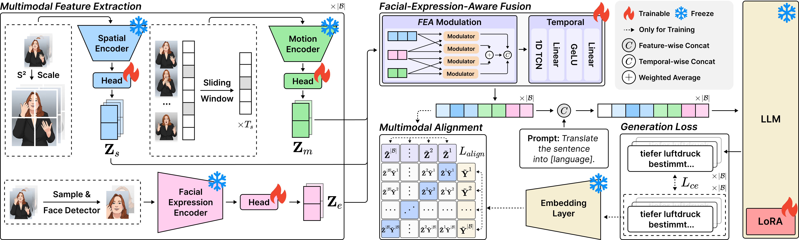

# FEA-SLT

Official implementation of **[FEA-SLT: A Gloss-Free End-to-End Framework for Facial-Expression-Aware Sign Language Translation](https://aclanthology.org/2026.emnlp-main.1999/)**, accepted to **EMNLP 2026 (Main Conference)**.



FEA-SLT fuses offline spatial, motion and facial-expression features from frozen visual encoders and trains the translation model with LoRA.

## Repository structure

```text
FEA-SLT/
├── configs/                  # Training and dataset configurations
├── dataset/                  # Datasets and feature loading
├── feaslt/                   # Model and fusion modules
├── script/                   # Preprocessing, training and evaluation
├── utils/                    # Supporting utilities
├── main.py                   # Main entry point
└── requirements.txt
```

## Install

FEA-SLT runs on Linux with Python 3.10 and an NVIDIA GPU supporting bf16.
The following environment uses PyTorch 2.0.1 with CUDA 11.8:

```bash
python3.10 -m venv .venv
source .venv/bin/activate
python -m pip install torch==2.0.1 --index-url https://download.pytorch.org/whl/cu118
python -m pip install -r requirements.txt
```

## Data and features

Download [PHOENIX14T](https://www-i6.informatik.rwth-aachen.de/~koller/RWTH-PHOENIX-2014-T/) or request [CSL-Daily](https://ustc-slr.github.io/datasets/2021_csl_daily/), then place it under `data/<dataset>/`.

Data layout:

```text
data/
├── Phoenix14T/
│   └── PHOENIX-2014-T/
│       ├── annotations/
│       │   └── manual/
│       │       ├── PHOENIX-2014-T.train.corpus.csv
│       │       ├── PHOENIX-2014-T.dev.corpus.csv
│       │       └── PHOENIX-2014-T.test.corpus.csv
│       └── features/
│           └── fullFrame-210x260px/
│               ├── train/<fileid>/*.png
│               ├── dev/<fileid>/*.png
│               └── test/<fileid>/*.png
└── CSL-Daily/
    ├── sentence-crop/
    │   └── <fileid>.mp4
    ├── csl_daily_label.pkl
    └── csl_daily_split.txt
```

Generate English, Spanish and French translations of training targets locally.
Save `translations.json` as an object keyed by the official sample IDs:

```json
{
  "sample_train": {"en_text": "English translation", "es_text": "Spanish translation", "fr_text": "French translation"}
}
```

Commands run from the repository root and use PHOENIX14T by default.
Face detection dependencies are listed in `requirements-preprocess.txt`.

```bash
# For CSL-Daily, set this before running the commands:
# export DATASET=CSL-Daily

bash script/prepare_annotations.sh --translations translations.json --check_media
bash script/crop_faces.sh
bash script/extract_spatial_features.sh
bash script/extract_motion_features.sh
bash script/extract_expression_features.sh
```

Outputs are written to `preprocess/<dataset>/`, `face_detection_results/<dataset>/` and `extracted_features/`, where `<dataset>` is `Phoenix14T` or `CSL-Daily`.

| Stream | Default encoder | Filename suffix / shape |
| --- | --- | --- |
| Spatial | CLIP ViT-L/14, S2 scales 1 and 2 | `_s2wrapping.npy`, `[T, 2048]` |
| Motion | VideoMAE-L/16, window 16, stride 8 | `_overlap-8.npy`, `[windows, 1024]` |
| Expression | FER2013 ViT-B/16, RetinaFace, stride 8 | `_stride-8.npy`, `[ceil(T/8), 768]` |

`T` is the frame count: PHOENIX14T uses native 25 FPS; CSL-Daily uses 30 FPS.
Set paths with `ANNO_ROOT`, `VIDEO_ROOT`, `FEATURE_ROOT` and `MODEL_CACHE`. The `--mode dev` option extracts one split, and `--overwrite` regenerates existing files. Expression feature loading uses matching `EXPRESSION_POSTFIX`, `expression_postfix` and `expression_sample_rate` settings.

## Train and evaluate

```bash
bash script/train.sh
DATASET=CSL-Daily bash script/train.sh

bash script/resume_train.sh logs/my_run
bash script/eval.sh logs/my_run/checkpoints/selected.ckpt
```

Final test evaluation uses the checkpoint selected by **dev BLEU-4**. PHOENIX14T uses FLAN-T5-XL; CSL-Daily uses mT5-XL. Paper configurations use three translation examples, shuffled during training and fixed at inference. The `train_ml.npy` file provides context-enabled evaluation data, and checkpoints store the fixed inference examples.

The context ablation supports training without multilingual annotations:

```bash
bash script/prepare_annotations.sh --check_media
python main.py -c configs/train.yaml configs/no_context.yaml
# CSL-Daily
DATASET=CSL-Daily bash script/prepare_annotations.sh --check_media
python main.py -c configs/train.yaml configs/csl_daily.yaml configs/no_context.yaml
```

Evaluation removes German punctuation and lowercases PHOENIX14T text; CSL-Daily uses characters and preserves punctuation. BLEU uses SacreBLEU `13a`/`zh`, and ROUGE-L uses word/character LCS. Scores use a 0–100 scale.

Additional metrics: `python -m utils.evaluate_punctuation_rouge --file results.json`.
BLEURT evaluation uses [BLEURT](https://github.com/google-research/bleurt) and [BLEURT-20](https://storage.googleapis.com/bleurt-oss-21/BLEURT-20.zip): `BLEURT_MODEL=./BLEURT-20 bash script/eval_bleurt.sh results.json`.

## Citation

Please cite our paper if you use this work:

```bibtex
@inproceedings{tu-weng-2026-fea,
  title={{FEA}-{SLT}: A Gloss-Free End-to-End Framework for Facial-Expression-Aware Sign Language Translation},
  author={Guobin Tu and Di Weng},
  booktitle={Proceedings of the 2026 Conference on Empirical Methods in Natural Language Processing},
  year={2026},
  pages={45546--45570},
  doi={10.18653/2026.emnlp-main.1999},
  url={https://aclanthology.org/2026.emnlp-main.1999/}
}
```

## Acknowledgments

Our work is based on the following repositories, and we thank the authors for their valuable contributions:

- [SpaMo](https://github.com/eddie-euijun-hwang/SpaMo)
- [CLIP-ViT-Large](https://huggingface.co/openai/clip-vit-large-patch14)
- [VideoMAE-Large](https://huggingface.co/MCG-NJU/videomae-large)
- [ViT-Face-Expression](https://huggingface.co/trpakov/vit-face-expression)
